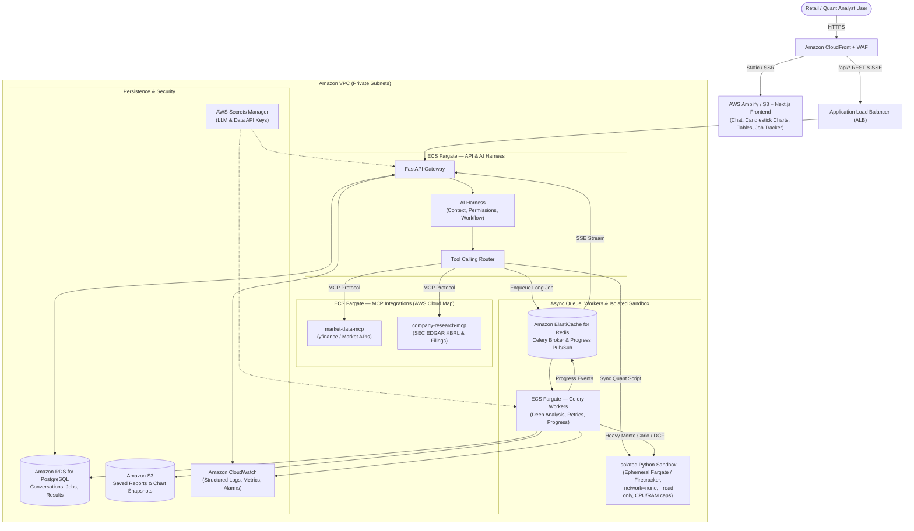
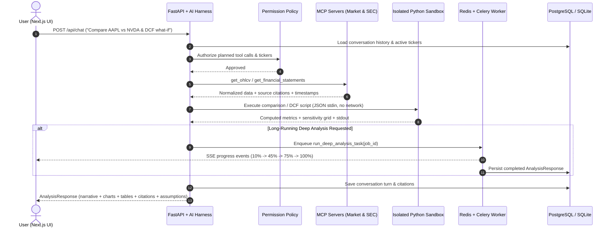

# AWS-Style System Architecture

## 1. High-Level AWS Service Topology

## 2. Conversational Request & Sandbox Data Flow

## 3. Security & Sandbox Isolation Controls
1. **AST Pre-Execution Guard (`services/sandbox/ast_guard.py`):** Blocks dangerous imports (`os`, `subprocess`, `socket`, `sys`, `http`, `requests`), forbidden builtins (`open`, `eval`, `exec`, `__import__`), and dunder attribute tampering before a container ever starts.
2. **Container Runtime Hardening (`services/sandbox/runner.py`):** Launches ephemeral containers with `--network none`, `--read-only`, `--tmpfs /tmp:rw,noexec,nosuid,size=64m`, `--cpus 1.0`, `--memory 512m`, `--pids-limit 64`, `--user 65534:65534`, and strict timeout limits.
3. **AI Harness Policy (`apps/api/app/harness/permissions.py`):** Allowlists tool names, validates ticker format (`^[A-Z]{1,5}(\.[A-Z]{1,2})?$`), and enforces source/assumption metadata on all responses.
