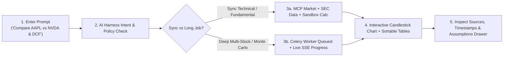

# Miro Board Blueprint — Research, User Journeys, Wireframes & System Flow

Use the frames below to populate your Miro board directly (stickies + Mermaid/flowchart blocks).

---

## Frame 1: Problem & User Research Synthesis
- **Pain Points Observed:**
  1. Investors switch between 4–6 tabs (charting tools, SEC EDGAR, Yahoo Finance, Excel) to evaluate a single stock.
  2. Generic chatbots hallucinate financial numbers and lack reproducible math or source citations.
  3. Complex peer comparisons and Monte Carlo simulations time out synchronous chat requests.
- **Target Personas:**
  - **Maya (Active Swing Trader):** Needs fast candlestick charts, RSI/MACD/SMA overlays, and volume confirmation.
  - **Devon (Fundamental Analyst):** Needs SEC 10-K/10-Q figures, margins, valuation multiples, and DCF what-if sensitivity grids.
  - **Priya (Portfolio Researcher):** Runs multi-ticker peer comparisons and 2,000-path Monte Carlo projections asynchronously.

---

## Frame 2: End-to-End User Journeys



---

## Frame 3: Low-Fidelity UI Wireframe

```text
+-----------------------------------------------------------------------------------+
| AlphaPulse AI Stock Market Assistant                          [AI Harness Ready]  |
+------------------------------------------------------+----------------------------+
| CONVERSATIONAL ANALYST WORKSPACE                     | BACKGROUND JOBS (CELERY)   |
|                                                      |                            |
|  [Quick Prompts: Technical | Fundamental | Compare]  |  +----------------------+  |
|                                                      |  | AAPL, MSFT  [SUCCESS]|  |
|  User: Show AAPL technical chart and RSI             |  | [============] 100%  |  |
|  Assistant: AAPL Technical Analysis ($212, +1.4%)    |  | Retries: 0           |  |
|  +------------------------------------------------+  |  | [Load Report ->]     |  |
|  | Candlestick + Volume + SMA20/50/BB Overlays    |  |  +----------------------+  |
|  | [SMA20] [SMA50] [EMA20] [RSI14] [MACD]         |  |                            |
|  +------------------------------------------------+  |  +----------------------+  |
|  | Oscillator Pane (RSI 14 / MACD)                |  |  | NVDA, AMD  [PROGRESS]|  |
|  +------------------------------------------------+  |  | [=======     ]  75%  |  |
|  | Sortable Indicator / Valuation / DCF Table     |  |  | Running Monte Carlo  |  |
|  +------------------------------------------------+  |  +----------------------+  |
|  > Sources (3) · Assumptions (2) · Tools [Inspect]   |                            |
|                                                      |                            |
| [Ask about any ticker, comparison, or what-if...] [Analyze]                       |
+------------------------------------------------------+----------------------------+
```

---

## Frame 4: System Flow & Tool Routing
1. **Ingress (`FastAPI`):** Receives chat prompt or job request.
2. **AI Harness:** Resolves active tickers from conversation context, checks `PermissionPolicy`, plans tool sequence.
3. **MCP Servers:**
   - `market-data-mcp` fetches OHLCV, quotes, and computes validated technical indicators.
   - `company-research-mcp` fetches SEC EDGAR CIK/filings, income/balance/cashflow statements, and valuation multiples.
4. **Python Sandbox:** Runs AST-checked comparison, DCF sensitivity, and Monte Carlo scripts in an isolated `--network=none` Docker container.
5. **Celery + Redis:** Handles heavy multi-ticker jobs with retry backoff, SSE progress updates, and saved DB reports.
